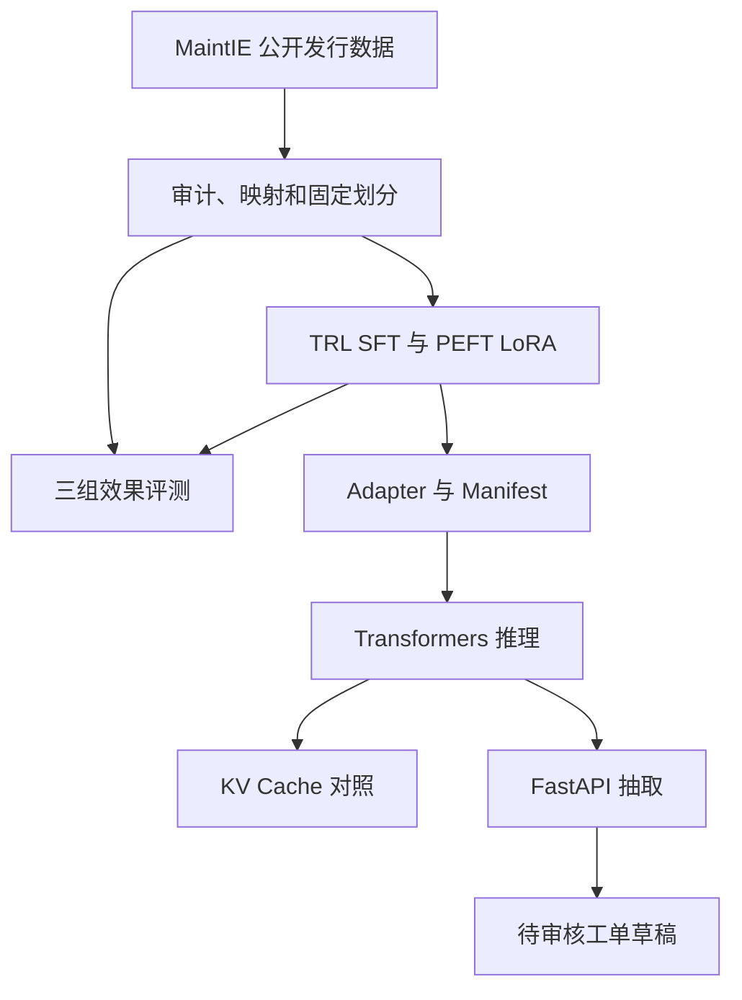

# 工业工单抽取架构与业务取舍

参考 Bosch Equipment Ticket Agent 的工单质量诉求。文本中设备、故障状态和维护行为的记录方式往往不统一，导致后续查找和汇总需要重复整理。抽取为固定字段后，维护人员可以逐项审核，报表和检索可以消费相同结构。

| 决策 | 取舍 |
|---|---|
| 结构化抽取 | 用原文和实体标签直接验收，可对遗漏、错类和跨度逐项复盘。维修建议需不同的证据与业务批准。 |
| 小型本地开源模型 | 同一底座可训练、重载、测缓存并离线部署。效果受模型规模和英文语料范围限制。 |
| Zero-shot / Few-shot / LoRA | Zero-shot 检验统一指令的能力。Few-shot 测试少量示例是否已经足够。LoRA 学习稳定映射和输出规律，增加训练与版本管理成本。 |
| RAG | 企业手册和标准经常变动，带来源的检索便于及时更新。它的价值在知识查询场景，工单抽取以工单原文为证据。 |
| 服务与流程 | FastAPI 只负责模型和输出契约，草稿与人工状态由客户端流程持有。制造、质量或报表客户端都可调用同一 `/extract`，业务可以独立演进。 |
| 延迟和成本 | BF16 小模型、限制序列和输出预算，实测 Cache 开关和显存。单 worker、无批处理为当前 MVP 的部署边界。 |
| 人工审核 | 结构与原文依据检查可挡住一部分错误，低置信或内容不全需要人工处理。草稿保留原文和模型版本，审批记录有时间和人员。 |
| 版本与回退 | 同一 Schema 下通过 Manifest 固定底座、数据和 Adapter，折回已验收的版本并重启。 |
| 跨场景迁移 | 供应链可以抽供应商、零件、交付异常和纠正措施，职能可抽申请事项、金额与日期。需要业务方重新标注与验收。 |

可衡量指标为字段漏抽率、原文外实体比例、人工修订率和每单审核耗时。当前公开语料实验能测前两项。后两项需要真实业务人员和对照流程。项目未估算真实生产效率提升。

nanochat 的参考点是训练入口、检查点管理、评测脚本与推理基准的清晰边界。本项目让 Transformers、PEFT、TRL 实现底层训练与生成，使学习重点集中在数据、损失、对照实验与部署。 [nanochat 固定版本](https://github.com/karpathy/nanochat/tree/92d63d4e8bb4df75c3b71618f31ddde2378b2bcd)
